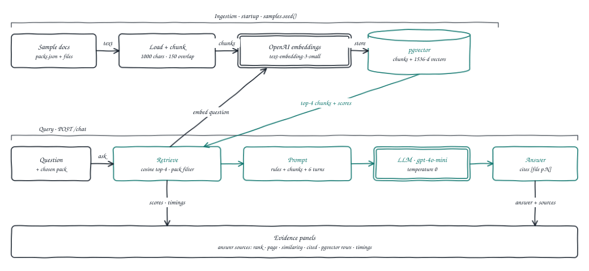

# RAG Demo

An open-source, MIT-licensed reference app for **semantic Retrieval-Augmented
Generation**, end to end. Every answer comes with a citation, and you can see
exactly which passages, similarity scores and database rows it came from.

The worked example is three small knowledge bases: HR policies, a residential
lease and a product manual. Pick one, ask a question, then click the answer to
inspect the evidence behind it.

It is meant to be read, run and forked. Swap the sample documents in
`backend/samples/` and the same pipeline answers questions about your own.

> **Status:** learning template and proof of concept. Not hardened for
> production — see [Known limits](#known-limits).

**Live demo:** [rag-demo.nitingoswami.io](https://rag-demo.nitingoswami.io) runs
in demo mode: the three sample knowledge bases, no uploads.



*The pipeline. Ingestion runs once at startup; each question then retrieves the
four closest chunks, places them in the prompt and answers with citations. The
teal path is retrieval → prompt → LLM.*

In CoALA terms, ingestion is a **learning action** that writes to **semantic
memory** (pgvector). Chat is a **retrieval action** that loads chunks into
**working memory** (the prompt), which the LLM then reasons over.

---

## What you can learn from it

- **Chunking and embedding.** Load, split (1000 characters, 150 overlap) and
  embed with `text-embedding-3-small`, de-duplicated by content hash, so
  restarts are cheap. `backend/app/ingest.py`
- **Scoped retrieval.** Cosine top-4 search filtered to one knowledge base via
  JSONB metadata, with the similarity score kept for every chunk.
  `backend/app/rag.py`
- **A grounding prompt.** The model answers only from retrieved context, cites
  `[file p.N]`, and says "I don't know based on the uploaded documents" when the
  answer isn't there. `backend/app/rag.py`
- **Evidence you can inspect.** Timings, token counts, a sources table and the
  raw pgvector rows behind each answer. `frontend/app/components/`
- **A safe public demo.** Uploads off by default, per-IP and global rate limits,
  and request size limits. `backend/app/main.py`

The full design, with hand-drawn architecture, sequence, state and data
diagrams, is in **[docs/DESIGN.md](docs/DESIGN.md)** (styled version:
[docs/design.html](docs/design.html)).

---

## Quick start

Prerequisites: Docker Desktop, Python 3.12, Node 20+, and an OpenAI API key.

```bash
git clone https://github.com/nitingoswami-io/rag-demo.git && cd rag-demo

# 1. Database (pgvector)
docker compose up -d

# 2. Backend  → http://localhost:8000  (API docs at /docs)
cd backend
python3.12 -m venv .venv && source .venv/bin/activate
pip install -r requirements.txt
cp .env.example .env          # then put your OPENAI_API_KEY in .env
uvicorn app.main:app --reload

# 3. Frontend → http://localhost:3000
cd ../frontend
cp .env.local.example .env.local
npm install && npm run dev
```

| Variable | Where | Used for |
|---|---|---|
| `OPENAI_API_KEY` | `backend/.env` | Embeddings and chat ([get a key](https://platform.openai.com/api-keys)) |
| `DATABASE_URL` | `backend/.env` | Postgres with pgvector (the default matches `docker compose`) |
| `ALLOW_UPLOADS` | `backend/.env` | `true` enables upload and delete (local mode only) |
| `MAX_UPLOAD_MB`, `CHAT_PER_MINUTE`, `GLOBAL_CHAT_PER_MINUTE` | `backend/.env` | Size and rate limits |
| `CHAT_MODEL`, `EMBEDDING_MODEL` | `backend/.env` | Optional model overrides (changing the embedding model needs a re-index) |
| `ALLOWED_ORIGINS`, `TRUST_PROXY` | `backend/.env` | Deployment: CORS origins, and reading the client IP behind a proxy |
| `NEXT_PUBLIC_API_URL` | `frontend/.env.local` | Where the browser calls the API (default `http://localhost:8000`) |

On startup the backend indexes the sample documents in `backend/samples/`, which takes a few seconds the first time. After that, unchanged files are skipped. Pick a knowledge base, click a suggested question, then click the answer to inspect it:

| Area | Shows |
|---|---|
| Left | Knowledge bases: the problem each one solves, its value, and its documents |
| Centre | Chat, which scrolls as it grows, with suggested questions |
| Right | How the answer was built: retrieve, augment and generate, with timings and token counts |
| Bottom | **Answer sources** (rank, document, page, chunk, similarity, cited) and **Database rows** (a read-only view of `langchain_pg_embedding`) |

To see the grounding rule in action, ask something the documents don't cover. The agent answers "I don't know based on the uploaded documents."

### Demo mode vs local mode

| | Demo mode (default) | Local mode (`ALLOW_UPLOADS=true` in `backend/.env`) |
|---|---|---|
| Sample knowledge bases | Read-only | Read-only |
| Upload and delete your own files | Disabled (`403`) | Yes, in a shared "Your documents" set |
| Limits | 20 chats per minute per IP | Also 5 files and 5 MB per upload, 10 uploads per minute |

Demo mode is the safe default for anything public. Visitors can't store documents, so there is no user data to protect, and the rate limit caps your OpenAI spend. Only enable uploads on your own machine. In either mode, question text and retrieved passages are sent to OpenAI to generate answers.

## Try it with curl

```bash
curl localhost:8000/packs                       # knowledge bases + documents
curl localhost:8000/packs/legal/rows            # read-only pgvector rows
curl -X POST localhost:8000/chat -H 'Content-Type: application/json' \
  -d '{"message":"Can I keep a dog in the flat?","history":[],"pack":"legal"}'

# Local mode only (ALLOW_UPLOADS=true)
curl -F files=@notes.md localhost:8000/upload
curl -X DELETE localhost:8000/documents/notes.md   # removes its chunks from pgvector
```

## How it works

```
Ingestion:  file → load → chunk (1000/150) → embed → pgvector          (samples at startup, POST /upload in local mode)
Query:      question → embed → top-4 search in one knowledge base → prompt → LLM → answer + sources   (POST /chat)
```

**Stack:** FastAPI · LangChain · PostgreSQL + pgvector · Next.js · OpenAI
(`gpt-4o-mini`, `text-embedding-3-small`).

### Where things live

| Path | What it does |
|---|---|
| `backend/samples/` | Fictional sample documents and `packs.json` (titles, value, suggested questions) |
| `backend/app/samples.py` | Indexes the samples at startup (skips unchanged files) |
| `backend/app/ingest.py` | Load → split → `add_documents` (embeds and stores), de-duplicated by content hash |
| `backend/app/rag.py` | Retrieve top-k within a pack → build prompt → `ChatOpenAI` → answer, sources with scores, timings |
| `backend/app/vectorstore.py` | `PGVector` store plus the SQL for documents, rows, de-duplication and delete |
| `backend/app/main.py` | FastAPI routes: `/config`, `/packs`, `/packs/{id}/rows`, `/chat`, `/upload`, `DELETE /documents/{name}`, `/health`; rate limits |
| `frontend/app/components/` | `KnowledgeBase`, `ChatPanel`, `InsightPanel`, `EvidencePanel`, `UploadPanel`, `MessageBubble` |
| `frontend/lib/api.ts` | `fetch` wrappers for the API |

## Adapting it

| You want to… | Change |
|---|---|
| Answer questions about your own documents | Add files and an entry to `backend/samples/packs.json` (title, audience, suggested questions) |
| Tune retrieval | `chunk_size`, `chunk_overlap`, `top_k`, `history_turns` in `backend/app/config.py` |
| Change the grounding rules or citation format | The system prompt in `backend/app/rag.py` |
| Use another chat or embedding model | `CHAT_MODEL` / `EMBEDDING_MODEL`; re-index after changing the embedding model |
| Use another vector store | `backend/app/vectorstore.py` (LangChain vector store interface) |

---

## Deploying your own copy (Supabase + Railway + Vercel)

| Part | Host | Root directory |
|---|---|---|
| Database (Postgres + pgvector) | **Supabase** | n/a |
| Backend (FastAPI) | **Railway** | `backend/` (start command in `backend/railpack.json`) |
| Frontend (Next.js) | **Vercel** | `frontend/` |

**1. Supabase.** Create a project. Under **Database → Extensions**, enable `vector`. Under **Connect**, copy the **Session pooler** URI. It's IPv4, port 5432, and works from Railway. Don't use the transaction pooler on port 6543, because it breaks prepared statements. Add `?sslmode=require` to the end.

**2. Railway.** Create a service from this GitHub repo, then set **Root Directory** to `backend`. Add these variables:

```
OPENAI_API_KEY=sk-...                      # only here, never in Vercel
DATABASE_URL=<Supabase session pooler URI>?sslmode=require
ALLOWED_ORIGINS=https://<your-app>.vercel.app
TRUST_PROXY=true
ALLOW_UPLOADS=false
```

In **Settings**, set the health check path to `/health`, and set Watch Paths to `backend/**` so that frontend-only pushes don't redeploy the backend. Then open **Settings → Networking → Generate Domain**. On its first start, the service creates the tables in Supabase and indexes the sample documents. This takes a few seconds and costs a fraction of a cent in embeddings. `/health` is the health check.

**3. Vercel.** Import the repo and set **Root Directory** to `frontend`. Add `NEXT_PUBLIC_API_URL=https://<your-service>.up.railway.app`, then deploy. If the Vercel URL changes, update `ALLOWED_ORIGINS` on Railway.

### Running a public demo with a spending limit

Every question spends OpenAI credit, so a public demo needs a ceiling:

1. **Hard cap at the provider.** Use prepaid credit with auto-recharge off, or a
   monthly budget on the key at platform.openai.com. This bounds the worst case.
2. **Per-visitor rate limits.** The backend allows 20 chats per minute per IP
   and 120 per minute in total (`CHAT_PER_MINUTE`, `GLOBAL_CHAT_PER_MINUTE`).
   The counters are in memory, per process, so run one backend instance or add
   a limit at your host's firewall too.
3. **Keep uploads off** (`ALLOW_UPLOADS=false`, the default) so visitors can't
   store documents or trigger embedding costs.

## Keeping API keys safe

- Your OpenAI key lives only in `backend/.env`, which git ignores, along with every other `.env*` file except the `*.example` templates.
- The key is used only by the backend. The browser only ever sees `NEXT_PUBLIC_API_URL`, so never put a key in a `NEXT_PUBLIC_*` variable.
- A pre-commit hook blocks commits that include env files or anything that looks like an API key. Turn it on once per clone:
  ```bash
  git config core.hooksPath .githooks
  ```
- GitHub secret scanning and push protection are enabled on this repo as a second line of defence.
- If a key is ever committed, revoke it at https://platform.openai.com/api-keys first. Deleting the commit isn't enough, because the key stays in git history and forks.

## Reset the index

```bash
docker compose down -v   # deletes the pgvector volume
```

## Known limits

- **No accounts or per-user isolation.** In local mode, uploads go into one
  shared "Your documents" set.
- **Vector search only.** No hybrid (BM25) search or reranker, which are the
  biggest retrieval-quality gains in real systems.
- **No streaming.** The answer arrives in one piece.
- **Chat history lives in the browser** and only the last 6 turns are sent.
- **Rate limits are in-memory** and per process; they reset on restart.

---

## Contributing

Forks and pull requests are welcome. Section 10 of [docs/DESIGN.md](docs/DESIGN.md#10-next-steps) lists extensions (hybrid search, agentic RAG, episodic memory, streaming), each with what it teaches. Read [CONTRIBUTING.md](CONTRIBUTING.md), then [fork the repo](https://github.com/nitingoswami-io/rag-demo/fork) or [open an issue](https://github.com/nitingoswami-io/rag-demo/issues/new).
Questions go in [Discussions](https://github.com/nitingoswami-io/rag-demo/discussions).

## License

[MIT](LICENSE) © 2026 Nitin Goswami
